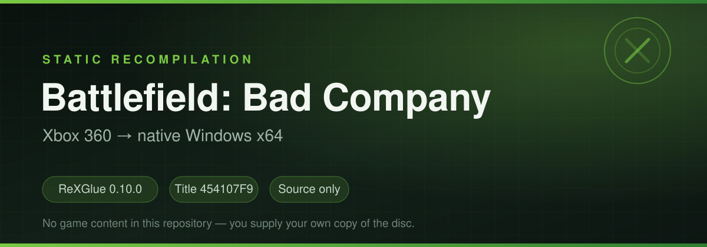

# Battlefield: Bad Company — Xbox 360 static recompilation for Windows



A **static recompilation** of *Battlefield: Bad Company* (Xbox 360, Title ID `454107F9`)
into a native Windows x64 application, built with **ReXGlue SDK 0.10.0**.

This repository contains **project code only** — no retail game content and no code
generated from it (`game/` and `generated/` are ignored; see below).

---

## Contents

| Path | Description |
|---|---|
| `CMakeLists.txt` | Builds `bfbc.exe` (WIN32) and stages the GPU plugin plus a linker map |
| `bfbc_manifest.toml` | Recompilation manifest: entry point, `setjmp/longjmp`, hand-discovered function entries |
| `src/main.cpp` | Registers the application (`REX_DEFINE_APP`) |
| `src/bfbc_app.h` | App hooks: launch defaults, GPU plugin preload, startup graphics values, input factory |
| `src/bfbc_graphics.h` | F5 overlay: display, resolution, VSync, frame cap, filtering, lighting/compatibility, mouse, key bindings |
| `src/bfbc_frame.h` / `.cpp` | Frame-rate cap paced at the guest's per-frame `VdSwap` import; owns `bfbc_fps_limit` |
| `src/bfbc_configzip.h` | Reads and rewrites `Render.ForceFov` inside `config.zz` for the F5 field-of-view slider |
| `src/bfbc_mouse.h` / `.cpp` | Mouse → right-stick shaping layer, and the input system that installs it |
| `src/bfbc_patches.cpp` | Stubs for the SDK's `XeKeys*` licence-signature functions |
| `build.ps1` | Full build: configure → codegen → branch repair → Ninja |
| `build/fix_gen_branches.ps1` | Rewrites codegen branches that become `REX_FATAL` although their label exists |
| `build/add_funcs.ps1`, `build/analyze_image.ps1` | Tooling for adding missing function entries to the manifest |
| `build/NOTES_missing_functions.md` | How missing functions were found without splitting existing ones |
| `build/run_bfbc.bat` | Short launcher (no longer required) |
| `RELEASE.md` | How the Windows package is assembled and published |

---

## Requirements

- Windows x64.
- **ReXGlue SDK 0.10.0** (`win-amd64`) — provides `rexglue.exe`, `rexruntime.dll` and `rexgpu-xenos.dll`.
- **LLVM/Clang 19.1.5**, **CMake 3.31.6**, **Ninja 1.13.2**.
- An `xwin` sysroot with MSVC 14.44 and Windows SDK 10.0.26100 (no Visual Studio install needed).

The toolchain paths are set at the top of `build.ps1`; point them at your machine.

---

## Game files (not included)

Place a copy **you own** in `gamedump/` so that it looks like this:

```
game/default.xex          # the title's executable image
game/Output/...           # content data
game/dist/...
game/dvd-prb/...
```

Nothing can be generated or run without `default.xex`.

---

## Build and run

```powershell
powershell -ExecutionPolicy Bypass -File build.ps1
build\bfbc.exe
```

`build.ps1` performs, in order:

1. CMake configure with Clang and the dynamic runtime.
2. `rexglue codegen bfbc_manifest.toml` — emits `generated/default/*` from `game/default.xex`.
3. `build/fix_gen_branches.ps1` — repairs codegen branch output before it is compiled.
4. Ninja build → `build/bfbc.exe`.

Running `bfbc.exe` on its own (double-click) is enough: it locates `..\game` (or `game\`
next to the executable), loads the `xenos` plugin, allows the title to write to `GAME:\`,
and then creates the graphics system.

A prebuilt Windows package is published under
[Releases](https://github.com/solidussnake95/battlefield-bad-company-xbox360-recomp-/releases).

---

## What this project adds on top of the SDK

1. **Launch defaults** (`OnConfigurePaths`): game data root, `gpu_plugin=xenos`,
   and `allow_game_relative_writes` — applied only when neither the command line
   nor `bfbc.toml` decides, so explicit settings always win.
2. **Internal resolution actually works** (`OnPreSetup`): the GPU plugin registers its
   cvars when its DLL is loaded, but the SDK loads that DLL during presentation setup,
   after `bfbc.toml` has been read. Saved `draw_resolution_scale_x/y` values were
   therefore dropped and the render-target cache was always built at 1×. The DLL is now
   preloaded so the cvars exist, the saved values are pushed in, and only then is the
   graphics system created. The renderer switches the menu no longer edits (they stay in
   `bfbc.toml`) take the same path, so they are in place before any render target or
   resolve pipeline is built.
3. **Mouse and keyboard** (`OnPreSetup` → `CreateShapedInputSystem`, `src/bfbc_mouse.cpp`):
   the SDK's default input system always registers its own `MnkInputDriver`, and a second
   keyboard/mouse driver cannot take over — `MnkInputDriver` reports one constant device
   handle and `InputSystem::DriverForDevice()` resolves that handle to the first driver
   that reported it. A wrapper registered next to it was consequently never polled, so
   `bfbc_mouse_gain/curve/deadzone` never applied. A custom `RuntimeConfig::input_factory`
   now builds the same system (SDL or XInput pads, NOP fallback) with the shaping driver in
   place of the SDK's: gain, response curve and deadzone are applied to the right stick
   after the driver, live, and the driver honours the runtime's active gate. The left
   mouse button fires and the right one aims out of the box: the SDK records mouse
   buttons as the virtual keys `LMB`/`RMB`, so they are bound to the pad's triggers
   (`keybind_right_trigger` / `keybind_left_trigger`) unless `bfbc.toml` already stores
   a binding for them. The shipped layout is A=F, B=C/Ctrl, X=R, LB=Q, RB=2, RT=LMB,
   LT=RMB and the d-pad on the arrow keys. Bindings are registered by the input module
   after the SDK has read `bfbc.toml`, so `OnConfigurePaths` pushes the file's
   `keybind_*` values itself before filling in any that are missing; otherwise every
   launch silently used the SDK defaults. Binding rows in F5 capture the next press
   instead of taking typed text, so mouse buttons (`LMB`/`RMB`/`MMB`), `Shift`,
   `Control`, `Alt` and the arrow keys can be bound; the names written are the ones the
   runtime's key parser accepts.
4. **F5 overlay** (`bfbc_graphics.h`): display mode, output resolution, internal
   resolution, VSync, frame rate limit, anisotropy, shader compilation, mouse sensitivity
   and every `keybind_*` — all saved to `bfbc.toml`; the field-of-view slider is the
   exception, written into `config.zz`
   because the engine only reads that value at boot.
5. **`bfbc_patches.cpp`**: `XeKeysConsolePrivateKeySign` and
   `XeKeysConsoleSignatureVerification` report success instead of 0, otherwise the
   title aborts on its disc check.
6. **`fix_gen_branches.ps1`**: turns `if (cond) REX_FATAL(...)` back into
   `if (cond) goto loc_XXXX;` where the emitter failed to classify a branch whose
   target label is present in the emitted body.

---

## Known limitations

- **Frame cap is host-side pacing**: SDK 0.10.0 exposes no limiter and
  `video_mode_refresh_rate` was measured to have no effect on pacing, so `bfbc_frame.cpp`
  wraps the guest's per-frame `VdSwap` import (the only once-per-frame point on the guest
  thread) and sleeps out the rest of the frame there. `F5 → Frame rate limit`
  (`bfbc_fps_limit`, 0 = uncapped) applies immediately and is saved to `bfbc.toml`; VSync
  still wins whenever the display rate is the lower of the two.
- **Field of view is a launch setting**: the engine reads `Render.ForceFov` from the
  `Game.cfg` override block at boot, so a running session cannot change it. F5 →
  Rendering is a 45–120° slider behind *Override field of view*; **Apply & save** rewrites
  `config.zz` (only `Game.cfg` is replaced, every other entry is copied byte for byte, and
  the new archive is re-parsed and compared before the file on disk is touched), reports
  "restart required", and the stored value is read back the next time the menu opens. The
  same value is reachable from the command line with
  `python tools\config_patch.py fov game\dist\xenon\config.zz 78` (`off` removes it). The
  key is from the engine's own setting table in the decompressed image, where `ForceFov`
  sits in the same class as `Render.PerfOverlayEnable`, which the config already drives.
- **Internal resolution changes** are saved to `bfbc.toml` and applied on the next
  launch, because the render-target cache is created once at startup.
- **The mouse is not raw input**: the title only reads an analog stick, so mouse look
  emulates the right stick and follows the game's own curve. The shaping layer makes that
  usable: it maps movement into `[floor, 1]` so slow aiming cannot fall inside the game's
  own deadzone (7849 of 32767, where the stick used to produce nothing at all), and it
  folds out the poll interval so the same hand speed turns the same amount at any frame
  rate. `gain`, `curve`, `deadzone`, `floor` and the frame-rate switch are all in F5,
  and the `PC aim` preset sets them to a starting point (gain 2.00, curve 0.75). A
  shaped value that reaches full deflection is still capped there, and the game's own
  acceleration/smoothing sits on top - true 1:1 PC aiming would mean patching its look
  code, not feeding the stick.
- **In-game button prompts stay Xbox 360 icons**: the title has no keyboard/mouse input
  path at all (it never calls `XamInputGetKeystroke` or any keyboard query, and
  `XamInputGetCapabilities` is only used to detect a wheel), and its only prompt art is the
  360 glyph set inside the Frostbite `.fbrb` UI bundles (`menu/main`, `menu/hud`). Swapping
  in PC-style icons means replacing textures in those bundles, not a cvar or a code switch.
  Because the prompts follow the pad buttons, they do track the binding: with the default
  mouse mapping, the fire prompt is the right-trigger icon.
- **The renderer/lighting switches are config-only now**: `Lighting / Compatibility` and
  `Shadows / depth` were removed from F5 at the owner's request, but the values they set
  stay in `bfbc.toml` (`draw_resolution_scaled_texture_offsets`, the resolve half-pixel
  flags, `d3d12_readback_resolve`, `depth_float24_*`, `gpu_3d_to_2d_texture`,
  `texture_cache_memory_limit_render_to_texture`) and are still pushed before GPU init on
  every launch, so the shadow and gamma fixes keep working. Changing one means editing
  that file; they all take effect at startup.
- Some optional assets produce `NtCreateFile` warnings (files absent from the disc
  image); they do not prevent startup.

---

## Legal

This repository contains **no** game content and **no** generated code derived from it.
`game/` and `generated/` are listed in `.gitignore`. To use this project you must own
a copy of the game.
