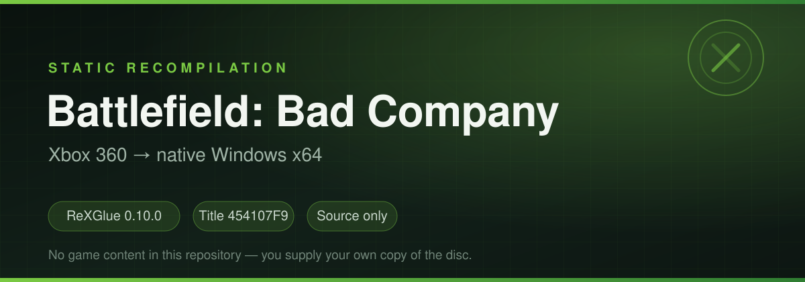

# Battlefield: Bad Company — Xbox 360 static recompilation for Windows



A **static recompilation** of *Battlefield: Bad Company* (Xbox 360, Title ID `454107F9`)
into a native Windows x64 application, built with **ReXGlue SDK 0.10.0**.

This repository contains **project code only** — no retail game content and no code
generated from it (`game/` and `generated/` are ignored; see below).

**Beta 2.0** adds dual pad backends (XInput + SDL), extra mouse-button mapping,
and F5 controls for the GPU readback mode and render target path. The release
package contains **no game files**.

---

## Contents

| Path | Description |
|---|---|
| `CMakeLists.txt` | Builds `bfbc.exe` (WIN32) and stages the GPU plugin plus a linker map |
| `bfbc_manifest.toml` | Recompilation manifest: entry point, `setjmp/longjmp`, hand-discovered function entries |
| `bfbc.toml.example` | Every `bfbc.toml` key, documented; not read by the game |
| `src/main.cpp` | Registers the application (`REX_DEFINE_APP`) |
| `src/bfbc_app.h` | App hooks: launch defaults, GPU plugin preload, startup graphics values, dual-pad input factory, overlay cursor watcher |
| `src/bfbc_graphics.h` | F5 overlay: display, resolution, VSync, filtering, readback resolve, render target path, mouse, key bindings |
| `src/bfbc_frame.h` / `.cpp` | Measures the guest's per-frame `VdSwap` rate and logs it (`Frame: 30.5 fps`); no limiter |
| `src/bfbc_configzip.h` | Reads and rewrites `Render.ForceFov` and `PostProcess.FilmGrainEnable` inside `config.zz` for the F5 sliders |
| `src/bfbc_mouse.h` / `.cpp` | Mouse → right-stick shaping, extra mouse buttons/wheel, and the dual XInput + SDL pad input system |
| `src/bfbc_patches.cpp` | Stubs for the SDK's `XeKeys*` licence-signature functions |
| `build.ps1` | Full build: configure → codegen → branch repair → Ninja |
| `build/fix_gen_branches.ps1` | Rewrites codegen branches that become `REX_FATAL` although their label exists |
| `build/add_funcs.ps1`, `build/analyze_image.ps1` | Tooling for adding missing function entries to the manifest |
| `build/NOTES_missing_functions.md` | How missing functions were found without splitting existing ones |
| `build/run_bfbc.bat` | Short launcher (no longer required) |
| `tools/shader_warmup.ps1` | Shader/pipeline cache warm-up: status, timed warm-up run, snapshot/restore |
| `RELEASE.md` | How the Windows package is assembled and published |
| `NOTES-Beta-2.0.md` | Release notes shipped with the current beta |

---

## Requirements

- Windows x64.
- **ReXGlue SDK 0.10.0** (`win-amd64`) — provides `rexglue.exe`, `rexruntime.dll` and `rexgpu-xenos.dll`.
- **LLVM/Clang 19.1.5**, **CMake 3.31.6**, **Ninja 1.13.2**.
- **Visual Studio 2022 Build Tools** with MSVC 14.44 and Windows SDK 10.0.26100; `build.ps1` sets `INCLUDE`/`LIB` itself, so no `vcvars` shell is needed.

The toolchain paths are set at the top of `build.ps1`; point them at your machine.

---

## Game files (not included)

Place a copy **you own** in `game/` so that it looks like this:

```
game/default.xex          # the title's executable image
game/Output/...           # content data
game/dist/...
game/dvd-prb/...
```

Nothing can be generated or run without `default.xex`.

---

## Build and run

```powershell
powershell -ExecutionPolicy Bypass -File build.ps1
build\bfbc.exe
```

`build.ps1` performs, in order:

1. CMake configure with Clang and the dynamic runtime.
2. `rexglue codegen bfbc_manifest.toml` — emits `generated/default/*` from `game/default.xex`.
3. `build/fix_gen_branches.ps1` — repairs codegen branch output before it is compiled.
4. Ninja build → `build/bfbc.exe`.

Running `bfbc.exe` on its own (double-click) is enough: it locates `..\game` (or `game\`
next to the executable), loads the `xenos` plugin, allows the title to write to `GAME:\`,
and then creates the graphics system.

A prebuilt Windows package is published under
[Releases](https://github.com/solidussnake95/battlefield-bad-company-xbox360-recomp-/releases).
The Beta 2.0 package contains no game files.

---

## What this project adds on top of the SDK

1. **Launch defaults** (`OnConfigurePaths`): game data root, `gpu_plugin=xenos`,
   and `allow_game_relative_writes` — applied only when neither the command line
   nor `bfbc.toml` decides, so explicit settings always win.
2. **Internal resolution actually works** (`OnPreSetup`): the GPU plugin registers its
   cvars when its DLL is loaded, but the SDK loads that DLL during presentation setup,
   after `bfbc.toml` has been read. Saved `draw_resolution_scale_x/y` values were
   therefore dropped and the render-target cache was always built at 1×. The DLL is now
   preloaded so the cvars exist, the saved values are pushed in, and only then is the
   graphics system created. The renderer switches the menu no longer edits (they stay in
   `bfbc.toml`) take the same path, so they are in place before any render target or
   resolve pipeline is built.
3. **Mouse and keyboard** (`OnPreSetup` → `CreateShapedInputSystem`, `src/bfbc_mouse.cpp`):
   the SDK's default input system always registers its own `MnkInputDriver`, and a second
   keyboard/mouse driver cannot take over — `MnkInputDriver` reports one constant device
   handle and `InputSystem::DriverForDevice()` resolves that handle to the first driver
   that reported it. A wrapper registered next to it was consequently never polled, so
   `bfbc_mouse_gain/curve/deadzone` never applied. A custom `RuntimeConfig::input_factory`
   now builds the same system (SDL or XInput pads, NOP fallback) with the shaping driver in
   place of the SDK's: gain, response curve and deadzone are applied to the right stick
   after the driver, live, and the driver honours the runtime's active gate. The left
   mouse button fires and the right one aims out of the box: the SDK records mouse
   buttons as the virtual keys `LMB`/`RMB`, so they are bound to the pad's triggers
   (`keybind_right_trigger` / `keybind_left_trigger`) unless `bfbc.toml` already stores
   a binding for them. The shipped layout is A=Space, B=C, X=R, Y=Q, LB=1, RB=2,
   Start=`Plus` (`+`/`=`), Back=`Minus` (`-`), RT=LMB, LT=RMB, WASD on the left stick,
   the d-pad on the arrow keys, and **no** keyboard keys on the right stick (the
   shaped mouse drives it; the same arrows used to move the camera and the d-pad).
   Bindings are registered by the input module
   after the SDK has read `bfbc.toml`, so `OnConfigurePaths` pushes the file's
   `keybind_*` values itself before filling in any that are missing; otherwise every
   launch silently used the SDK defaults. Binding rows in F5 capture the next press
   instead of taking typed text, so mouse buttons (`LMB`/`RMB`/`MMB`), `Shift`,
   `Control`, `Alt` and the arrow keys can be bound; the names written are the ones the
   runtime's key parser accepts.
   Pads: `bfbc_pad_backend` defaults to `both`. XInput is opened for Xbox pads and
   SDL for PlayStation pads at the same time, so either works without a restart and
   hot-plug is handled by the input system; `xinput` and `sdl` pin one backend. With
   both open, a `SharedAssignment` merges the devices into guest user 0 instead of
   leaving a phantom second player. The middle/back/forward mouse buttons and the
   wheel are mapped by `bfbc_mouse_middle`, `bfbc_mouse_x1`, `bfbc_mouse_x2` and
   `bfbc_mouse_wheel` (pad action names such as `b`, `x`, `lt`, `dpad_up`).
4. **F5 overlay** (`bfbc_graphics.h`): display mode, output resolution, internal
   resolution, VSync, anisotropy, async shader compilation, readback resolve, render
   target path, mouse gain/curve/deadzone and every `keybind_*` — all saved to
   `bfbc.toml`; the field-of-view slider and the film-grain switch are the exceptions,
   written into `config.zz` because the engine only reads those values at boot.
   `readback_resolve` (`none`/`fast`/`some`/`full`) is the plugin's string enum;
   `fast` is the default that brightens the world on this driver. The render target
   path is `rtv` (faster, but approximated HDR formats make smoke look wrong) or
   `rov` (accurate transparency, but new blend/depth states compile pipelines and
   can hitch; some AMD drivers also crash). Both need a restart because the render
   target cache is built once at startup, and the menu writes the choice without
   applying it to the running session.
5. **`bfbc_patches.cpp`**: `XeKeysConsolePrivateKeySign` and
   `XeKeysConsoleSignatureVerification` report success instead of 0, otherwise the
   title aborts on its disc check.
6. **`fix_gen_branches.ps1`**: turns `if (cond) REX_FATAL(...)` back into
   `if (cond) goto loc_XXXX;` where the emitter failed to classify a branch whose
   target label is present in the emitted body.
7. **Startup graphics defaults** (`bfbc_app.h`): `readback_resolve=fast`,
   `async_shader_compilation=true`, and 256/1024/2048 MB texture-cache limits are
   pushed before GPU init, so a regenerated `bfbc.toml` cannot silently fall back to
   the darker/synchronous defaults. The old `gamma_render_target_as_unorm16=false`
   override is gone; the plugin default is correct.
8. **`bfbc.toml` is treated as a hand-editable file** (`bfbc_graphics.h`): a save
   replaces the values in place instead of rebuilding the file, keeps comments, only
   appends keys the file did not have, drops the flags this build removed
   (`bfbc_fps_limit`, `resolution_scale`, `d3d12_readback_resolve`), and writes through
   a temp file + rename so a crash cannot truncate it. At startup `bfbc_app.h` checks
   every key against the registry and warns about unknown names and about values
   outside a flag's range/allowed set — the runtime returns `false` for those and logs
   nothing, which is how `bfbc_mouse_smooth = 1.0` (range 0..0.9) sat in a config for
   days applying nothing. `bfbc.toml.example` documents the whole surface.

---

## Known limitations

- **Shader / pipeline cache**: the runtime keeps everything it translated and every
  D3D12 pipeline description it built under
  `Documents\bfbc\cache\shaders\shareable\` (`*.xsh`, `*.rtv/rov.d3d12.xpso`) and
  rebuilds them in ~0.4 s at startup, so a state that was already seen costs
  nothing later. States that were never seen still compile on first use and are
  appended when the process exits, which is what the first-visit hitching is.
  `tools\shader_warmup.ps1` reports how warm the cache is, runs the game for N
  minutes and prints how much the cache grew (no growth = warm), and
  snapshots/restores a warm cache. RTV and ROV keep separate caches.
- **Render target path trade-off**: `rtv` is the default for speed, but the Xbox
  360's 10-bit HDR formats have to be approximated, so smoke and translucent
  particles can look hard-edged or too opaque. `rov` blends in the pixel shader and
  fixes that, but every new blend/depth state compiles a pipeline (first-use
  hitches), and the ROV path can crash on AMD drivers with SDK 0.10.0
  (`XEvent::Set` null event). Use `rtv` for a stable session; the F5 option saves
  `rov` for the next launch if you want to test it.
- **The game runs at its own ~30 Hz, and there is no frame limiter**: the engine's loop is
  fixed at 30.0 frames per second regardless of what the host can do, so a cap can
  only make it slower. The limiter was therefore removed, and `bfbc.toml` files that
  still contain `bfbc_fps_limit` keep working (the key is accepted and ignored).
  `bfbc_frame.cpp` logs the measured rate and the shortest/longest gap between swaps
  every two seconds to `bin\logs\bfbc_NNN.log` as `Frame: 30.0 fps (gap 32.7-33.9 ms)`;
  earlier builds logged 30.5 here because the counter included the first frame of the
  window in the rate but not in the elapsed time. GPU driver overlays show a much higher
  number because the host presents the same image many times per second when VSync is off.
  The gap range is the useful number: a steady rate with a wide range is what reads as
  stutter on screen, so keep VSync on (a 30.0 fps source then occupies exactly two
  refreshes of a 60 Hz display).
- **A higher frame rate is not available, and frame rate equals game speed**: the
  engine advances one fixed simulation step per frame, so running the render loop
  faster runs the whole game faster. Measured: `Game.MaxFps 60` is quantised back to
  30, `Game.MaxFps 0` removes the engine's pacing entirely (~500 fps), and
  `video_mode_refresh_rate` does not affect the rate. What does work is lifting the
  engine cap and pacing the swap in `bfbc_frame.cpp`: `bfbc_pace_fps = 60` holds a
  measured 60.0 fps (16.4-16.9 ms gaps) — but at double game speed, because the
  simulation step does not scale. A usable 60 fps mod therefore needs the per-frame
  simulation step itself patched to half, which is engine code work, not a setting.
  `bfbc_pace_fps = 0` (the default) leaves the engine's own 30 fps pacing in charge.
- **Field of view is a launch setting**: the engine reads `Render.ForceFov` from the
  `Game.cfg` override block at boot, so a running session cannot change it. F5 →
  Rendering is a 45–120° slider behind *Override field of view*; **Apply & save** rewrites
  `config.zz`: `Game.cfg` is rewritten, and so is any other entry that carries the same
  keys (in practice `ObjectViewer.cfg`, for `PostProcess.FilmGrainEnable`), while every
  other entry is copied byte for byte; the new archive is re-parsed and compared before
  the file on disk is touched. The dialog reports
  "restart required", and the stored value is read back the next time the menu opens. The
  same value is reachable from the command line with
  `python tools\config_patch.py fov game\dist\xenon\config.zz 78` (`off` removes it). The
  key is from the engine's own setting table in the decompressed image, where `ForceFov`
  sits in the same class as `Render.PerfOverlayEnable`, which the config already drives.
- **Film grain is off by default and is a launch setting**: F5 → Rendering has a
  *Film grain* checkbox backed by `PostProcess.FilmGrainEnable` in `Game.cfg`. The
  engine reads it at boot, so toggling it and pressing **Apply & save** rewrites
  `config.zz` and reports "restart required". The port ships with the value `false`;
  the same switch is reachable through `python tools\config_patch.py apply` profiles,
  which now keep it off.
- **Internal resolution changes** are saved to `bfbc.toml` and applied on the next
  launch, because the render-target cache is created once at startup.
- **The mouse is not raw input**: the title only reads an analog stick, so mouse look
  emulates the right stick and follows the game's own curve. The shaping layer makes that
  usable: it maps movement into `[floor, 1]` so slow aiming cannot fall inside the game's
  own deadzone (7849 of 32767, where the stick used to produce nothing at all), and it
  folds out the poll interval so the same hand speed turns the same amount at any frame
  rate. `gain`, `curve`, `deadzone`, `floor` and the frame-rate switch are all in F5,
  and the `PC aim` preset sets them to a starting point (gain 2.00, curve 0.75). A
  shaped value that reaches full deflection is still capped there, and the game's own
  acceleration/smoothing sits on top - true 1:1 PC aiming would mean patching its look
  code, not feeding the stick.
- **Shift, Ctrl and Alt work as action keys**: the SDK's MnK driver matches modifier
  masks exactly, which means a bare `Shift` binding can never fire (holding the key
  makes the live mask non-zero while the binding asks for zero). F5 and the startup
  config loader therefore store it as `Shift+Shift` (`Control+Control`, `Alt+Alt`) and
  the row still displays `Shift` / `Control` / `Alt`. Combined bindings such as the
  default `Shift+Up` d-pad mapping are unchanged, and `Ctrl` / `LeftCtrl` values saved
  by older builds are rewritten to the working form on load.
- **In-game button prompts stay Xbox 360 icons**: the title has no keyboard/mouse input
  path at all (it never calls `XamInputGetKeystroke` or any keyboard query, and
  `XamInputGetCapabilities` is only used to detect a wheel), and its only prompt art is the
  360 glyph set inside the Frostbite `.fbrb` UI bundles (`menu/main`, `menu/hud`). Swapping
  in PC-style icons means replacing textures in those bundles, not a cvar or a code switch.
  Because the prompts follow the pad buttons, they do track the binding: with the default
  mouse mapping, the fire prompt is the right-trigger icon.
- **The renderer/lighting switches are config-only now**: `Lighting / Compatibility` and
  `Shadows / depth` were removed from F5 at the owner's request, but the values they set
  stay in `bfbc.toml` (`draw_resolution_scaled_texture_offsets`, the resolve half-pixel
  flags, `readback_resolve`, `depth_float24_*`, `gpu_3d_to_2d_texture`,
  `texture_cache_memory_limit_render_to_texture`) and are still pushed before GPU init on
  every launch, so the shadow and gamma fixes keep working. Changing one means editing
  that file; they all take effect at startup.
- Some optional assets produce `NtCreateFile` warnings (files absent from the disc
  image); they do not prevent startup.

---

## Legal

This repository contains **no** game content and **no** generated code derived from it.
`game/` and `generated/` are listed in `.gitignore`. To use this project you must own
a copy of the game.
